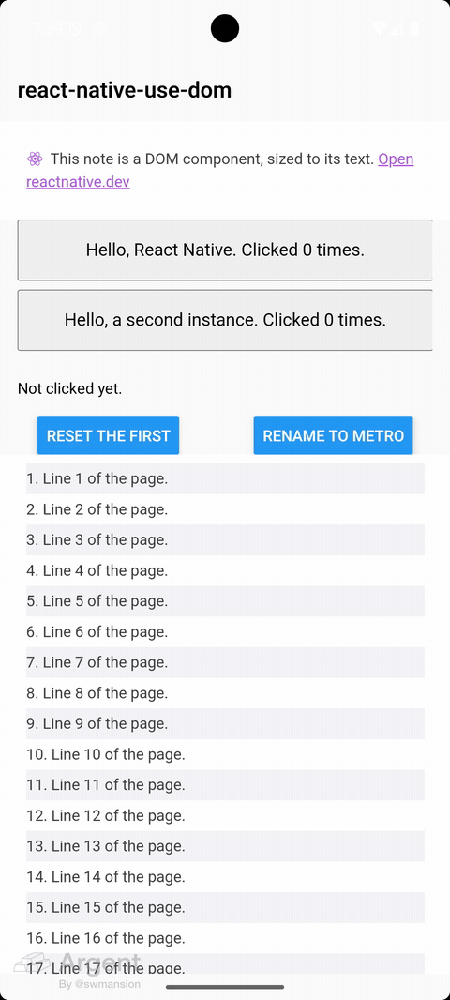
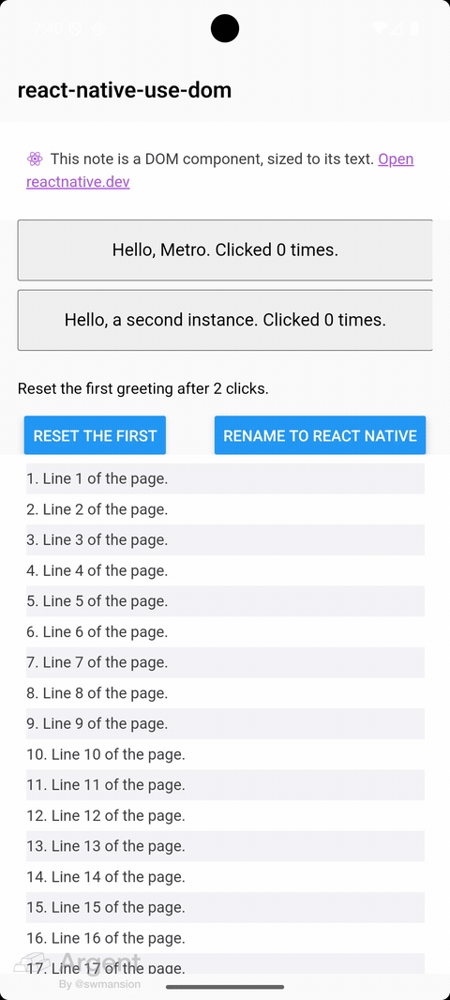

# react-native-use-dom

· [Tested React Native versions](./docs/compatibility.md)

Render React DOM components inside React Native with the `'use dom'` directive, without Expo.

A module marked `'use dom'` runs in a native web view on iOS and Android, and native code renders it like any
other component: props go in, function props become native actions the component can await, and methods it
exposes are reachable through a `ref`. Release builds ship every page with the JS bundle, so components load
offline and update with it over the air.

	
	&nbsp;&nbsp;&nbsp;
	

Function props, ref methods and props cross the bridge in both directions · Fast Refresh keeps the component's state

- **Use it:** [the package README](./packages/react-native-use-dom/README.md), then the [guide](./docs/README.md).
- **Coding agents:** [`AGENTS.md`](./packages/react-native-use-dom/AGENTS.md) has the rules in one page.

## Repository

| Path                                                               | What it holds                                                                 |
| ------------------------------------------------------------------ | ----------------------------------------------------------------------------- |
| [`packages/react-native-use-dom`](./packages/react-native-use-dom) | the library: Babel plugin, Metro integration, runtimes, native view           |
| [`examples/bare-0.87`](./examples/bare-0.87)                       | a React Native Community CLI app, without Expo                                |
| [`examples/expo-57`](./examples/expo-57)                           | an Expo app with a development build                                          |
| [`examples`](./examples)                                           | the same app on the other React Native versions and Expo SDKs the tests cover |
| [`e2e/example-app`](./e2e/example-app)                             | the DOM components and screens every example app renders                      |
| [`.argent/flows`](./.argent/flows)                                 | the end-to-end tests that drive the example apps                              |
| [`docs`](./docs)                                                   | the user guide                                                                |
| [`wiki`](./wiki)                                                   | the product and architecture decisions                                        |

## Develop

[CONTRIBUTING.md](./CONTRIBUTING.md) covers setting up the repository, the checks CI runs, the git hooks, the
generated docs and the end-to-end tests. To run an example app on a simulator or device, follow its README:
[bare React Native](./examples/bare-0.87/README.md#run-it) or [Expo](./examples/expo-57/README.md#run-it).

## License

[MIT](./LICENSE)
